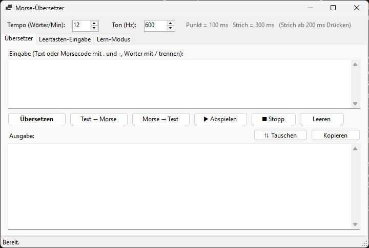
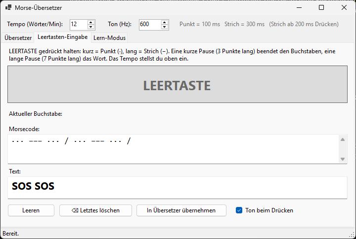
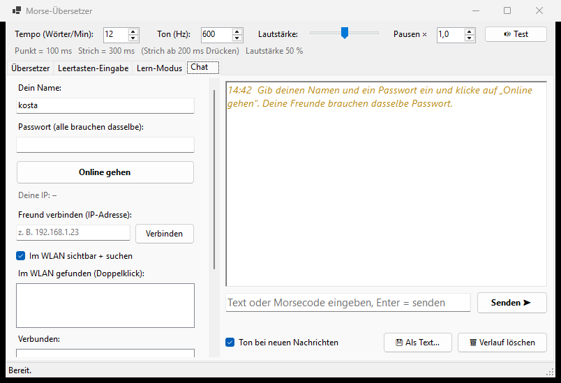
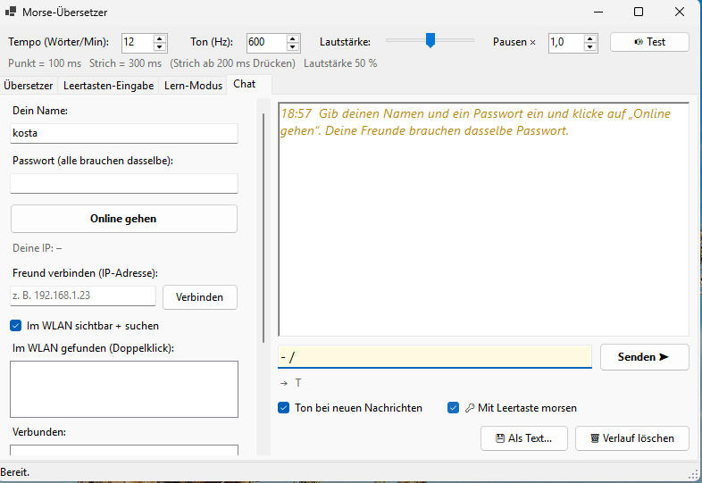

# Lern-Periode-2

# 06.11.2026 | Projekt: Morse-Übersetzer

## Heute

Ich habe den Morse-Übersetzer fertig gemacht. Er übersetzt Text in Morsecode und zurück und kann den Code als Ton abspielen. Mit der Leertaste kann ich selbst morsen: kurz ist ein Punkt, lang ein Strich. Im Lern-Modus übe ich die Buchstaben. Dabei hatte ich grosse Hilfe von KI.

Ich hatte einige Fehler: Die Codetabelle stand in der falschen Datei, und die Umlaute waren kaputt.

Gelernt habe ich:
- Ein Strich ist 3-mal so lang wie ein Punkt.
- Mit einer `Stopwatch` messe ich, wie lange die Leertaste gedrückt ist.

**Status:** fertig – den Ton und die Leertaste muss ich noch testen.

**Wichtig:** Weil es viele Dateien sind, habe ich sie auf Branches hochgeladen.

## Nächstes Mal

- [x] Den Ton und die Leertaste testen
- [x] Mit Hilfe der KI den Code besser verstehen
- [x] Den Punktestand im Lern-Modus speichern
- [ ] Einen kleinen Teil des Codes selbst ohne KI ändern

Danach will ich im Lern-Modus ganze Wörter üben.

# 06.11.2026 (Nachmittag) | Projekt: Morse-Übersetzer

## Heute

Ich habe die Ziele von heute Morgen bearbeitet. Ich habe den Ton und die Leertaste getestet, und der Lern-Modus speichert jetzt meinen Punktestand. Auch die neue Erklärung zum Code habe ich gelesen. Dabei hatte ich wieder grosse Hilfe von KI.

Ich hatte einen grossen Fehler: Die Leertaste hat nicht funktioniert. Das Feld blieb gelb, und es kam kein Buchstabe. Der Grund war, dass das Stoppen des Tons fast 1 Sekunde gedauert hat und das Programm so lange eingefroren war.

Gelernt habe ich:
- `SoundPlayer.Stop()` ist zu langsam. Mit `waveOut` von Windows stoppt der Ton sofort.
- Mit JSON kann ich den Punktestand in einer Datei speichern und beim Start wieder laden.

**Status:** fertig – die Leertaste erkennt jetzt „SOS SOS“ richtig.

## Nächstes Mal

- [ ] Einen kleinen Teil des Codes selbst ohne KI ändern
- [ ] Mit Hilfe der KI die Datei `MorseAudio.cs` besser verstehen
- [ ] Den Ton selbst anhören und die beste Tonhöhe finden
- [ ] Im Lern-Modus alle 5 Stufen ausprobieren

Danach will ich im Lern-Modus ganze Wörter üben.

# 20.11.2026 | Projekt: Morsecode-Programm (Chat)

## Heute

Ich habe heute mit Claude meine Morsecode-Projektdateien direkt am Laptop durchgeschaut, um zu sehen, wie weit der Chat-Teil schon ist. Dabei habe ich gesehen, dass ich den WLAN-Chat, den Internet-Chat und sogar einen Browser-Chat mit QR-Code schon fertig eingebaut habe, inklusive Verschlüsselung der Nachrichten.

**Status:** Chat-Funktion (WLAN, Internet, Browser/QR) ist fertig und ins Programm eingebaut.

## Zusammenfassung

Übersetzer, Lern-Modus mit Fortschritt, Morsetaste mit Ton und Design sind fertig. Der Chat ist schon viel weiter als geplant: WLAN, Internet und sogar ein Browser-Chat mit QR-Code funktionieren bereits, und die Nachrichten sind verschlüsselt.

## Ausblick

Als Nächstes will ich das Programm mit Freunden in der Praxis testen, um zu sehen, wo es noch Fehler gibt. Danach will ich die Ton-Einstellungen verbessern, eine neue Übung mit ganzen Wörtern einbauen, den Chatverlauf speichern können und am Schluss eine fertige .exe mit Anleitung machen.

## Nächstes Mal

- [ ] Praxistest mit Freunden machen
- [x] Ton-Einstellungen verbessern
- [x] Übung mit ganzen Wörtern einbauen
- [x] Chatverlauf speichern
- [x] Fertige .exe + Anleitung erstellen

# 20.11.2026 (Nachmittag) | Projekt: Morse-Übersetzer

## Heute

Der Chat war nur im alten Projekt `MorseCode`. Ich habe ihn jetzt in den Morse-Übersetzer übernommen, er ist ein neuer Tab „Chat“. Ausserdem habe ich die Ton-Einstellungen verbessert (Lautstärke und längere Pausen), eine Übung mit ganzen Wörtern eingebaut und den Chatverlauf speicherbar gemacht. Am Schluss habe ich eine fertige `Morse.exe` mit Anleitung erstellt. Dabei hatte ich wieder grosse Hilfe von KI.

Ich hatte einen Fehler: Im Chat-Tab war ein Button über einer Checkbox, und links gab es einen unnötigen Scrollbalken. Ich habe die Texte kürzer gemacht.

Gelernt habe ich:
- Mit `dotnet publish` und `--self-contained` wird eine `.exe` gemacht, die auch ohne installiertes .NET läuft.
- Wenn man nur die Pausen länger macht (Farnsworth-Methode), hört man die Buchstaben beim Lernen besser.

**Status:** fertig – 24 automatische Tests sind ok. Mit echten Freunden habe ich den Chat noch nicht getestet.

## Nächstes Mal

- [ ] Praxistest mit Freunden machen
- [ ] Die `Morse.exe` auf GitHub unter „Releases“ hochladen
- [ ] Mit Hilfe der KI `ChatNode.cs` besser verstehen
- [ ] Einen kleinen Teil des Codes selbst ohne KI ändern

Danach will ich mit Freunden einen ganzen Morse-Chat machen.

# 26.11.2026 | Projekt: Morse-Übersetzer

## Heute

Heute habe ich den Chat getestet. Meine Freunde waren nicht da, darum habe ich mit der KI einen „Test-Freund“ gebaut, der sich wie ein zweiter Laptop über WLAN verbindet. Den Browser-Chat und den Internet-Link habe ich im Browser ausprobiert. Die Nachrichten kamen überall an. Neu kann man im Chat **direkt mit der Leertaste morsen**: Haken setzen, morsen, mit der Rücktaste löschen und mit Enter senden. Am Schluss habe ich die Version 1.1 als neue `Morse.exe` gemacht und auf GitHub hochgeladen. Dabei hatte ich wieder grosse Hilfe von KI.

Ich hatte einige Fehler: Bei einem falschen Passwort hat man bei mir nichts gesehen. Im Browser stand oben nicht, wer neu dazugekommen ist. Wenn das Programm zweimal offen war, kam eine englische Fehlermeldung. Im kleinen Fenster hat eine Checkbox den Knopf „Als Text…“ verdeckt. Alle vier Fehler sind behoben.

Gelernt habe ich:

* Eine TCP-Verbindung kann auch ohne Fehler zugehen. Darum muss man nach der `while`-Schleife prüfen, ob der Freund schon `hello` gesagt hat.
* Mit `catch (SocketException ex) when (...)` fängt man nur einen bestimmten Fehler ab, z. B. `AddressAlreadyInUse`.
* `-p:EnableCompressionInSingleFile=true` macht die `.exe` etwa halb so gross (72 MB statt 154 MB).

**Status:** fertig – WLAN, Browser, Internet-Link und Morsetaste im Chat funktionieren auf meinem PC. Mit echten Freunden und einem echten Handy habe ich es noch nicht getestet.

## Zusammenfassung

Von den 4 Arbeitspaketen habe ich drei geschafft: Fehler beheben, Morsetaste im Chat und die Erklärung von `ChatNode.cs` (steht jetzt in [CODE-ERKLAERUNG.md](CODE-ERKLAERUNG.md)). Den Praxistest habe ich nur auf meinem PC mit einem Test-Freund gemacht. Die neue Version 1.1 kann man auf GitHub herunterladen.

## Ausblick

Als Nächstes will ich den Chat endlich mit echten Freunden und Handys testen. Ausserdem will ich zeigen, dass ich `ChatNode.cs` verstehe, indem ich die Testfragen beantworte und selbst etwas ohne KI ändere.

## Nächstes Mal (4 Arbeitspakete)

- [ ] **Praxistest mit Freunden:** Chat über WLAN, Handy-Browser und Internet-Link mit echten Geräten testen und Fehler notieren
- [ ] **Fehler beheben:** die gefundenen Fehler reparieren und eine neue `.exe` hochladen
- [ ] **Code verstehen:** die 3 Testfragen zu `ChatNode.cs` in [CODE-ERKLAERUNG.md](CODE-ERKLAERUNG.md) beantworten
- [ ] **Selbst ändern:** Aufgabe 5 oder 6 aus der Code-Erklärung ohne KI lösen

Danach will ich mit Freunden einen ganzen Morse-Chat nur mit der Leertaste machen.
