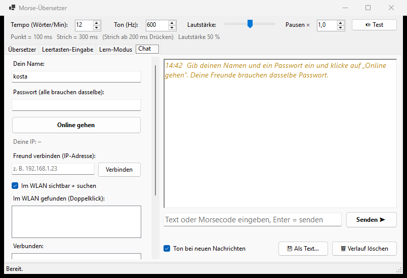

# 📡 Morse-Übersetzer

Ein Windows-Programm (C#, WinForms, .NET 8) zum **Übersetzen**, **Lernen** und **Chatten** mit Morsecode.



## Funktionen

- **Übersetzer:** Text ↔ Morse, mit Ton zum Anhören
- **Leertasten-Eingabe:** selbst morsen (kurz = Punkt, lang = Strich)
- **Lern-Modus:** einzelne Zeichen und ganze Wörter in 5 Stufen, der Punktestand wird gespeichert
- **Chat:** über WLAN, im Handy-Browser (QR-Code) oder über das Internet, mit verschlüsselten Nachrichten
- **Ton-Einstellungen:** Tempo, Tonhöhe, Lautstärke und längere Pausen zum Lernen

## Download

Die fertige `Morse.exe` gibt es unter **[Releases](../../releases)**. Man muss nichts installieren.
Wie es funktioniert, steht in der **[Anleitung](ANLEITUNG.md)**.

## Dokumentation

- [DOKUMENTATION.md](DOKUMENTATION.md): mein Lernjournal
- [SITZUNG.md](SITZUNG.md): Sitzungsbericht vom 20.11.2026 mit der Planung
- [CODE-ERKLAERUNG.md](CODE-ERKLAERUNG.md): was jede Datei macht

## Selbst bauen

```
dotnet build
dotnet publish -c Release -r win-x64 --self-contained true -p:PublishSingleFile=true -o publish
```

Schrift „Press Start 2P“: SIL Open Font License (siehe `fonts/OFL.txt`).
